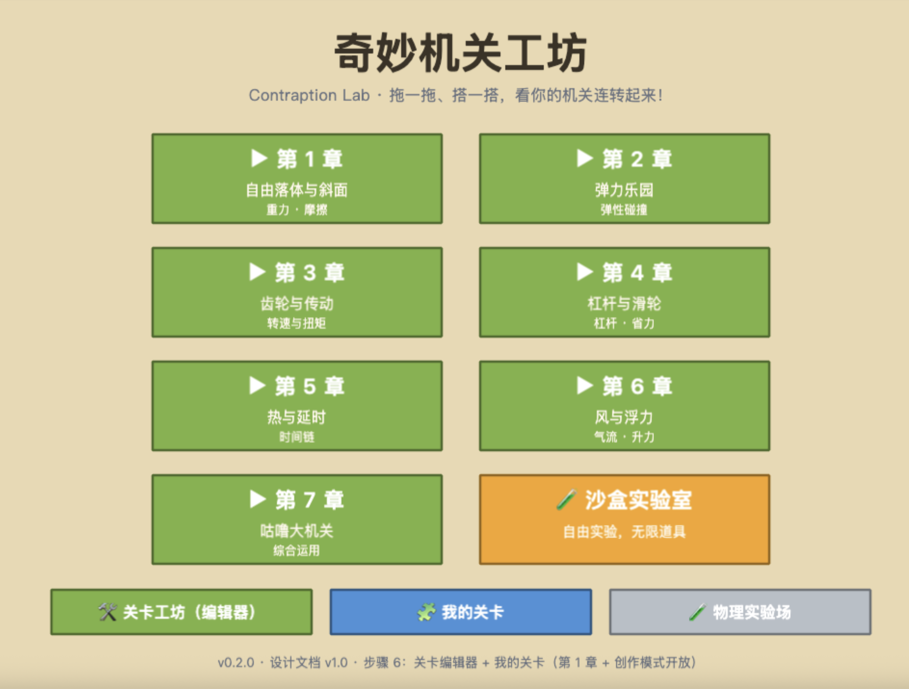
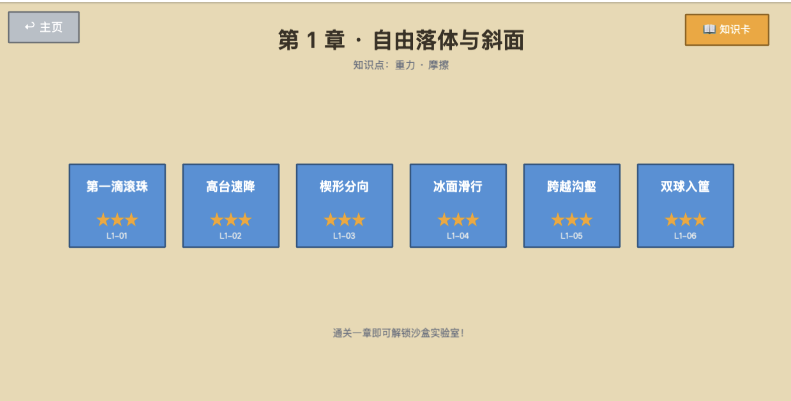
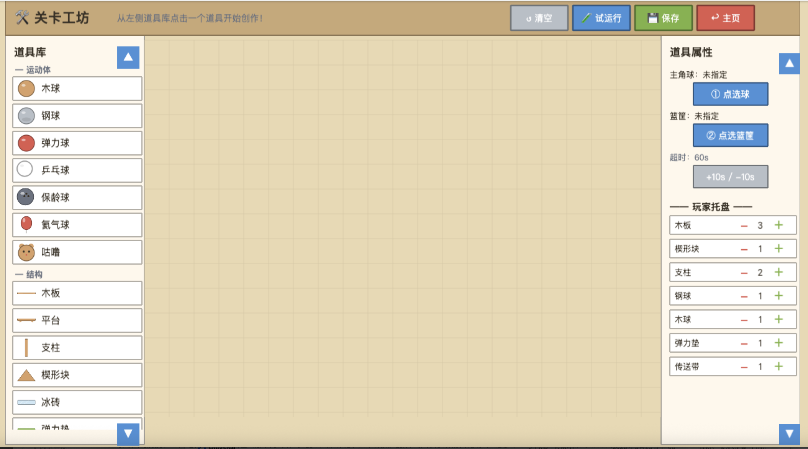

# 奇妙机关工坊 Contraption Lab

一个面向小学生的 **2D 物理连锁机关（Rube Goldberg）解谜 + 关卡创作平台**。
拖放物理道具组装联动装置，按下「启动！」看它连锁运转达成目标；还能用内置编辑器自己设计关卡。

> 灵感致敬《Return of the Incredible Machine: Contraptions》

## ✨ 三大模式

| 模式 | 说明 |
|------|------|
| **闯关模式** | 7 大主题章节 × 6 关 = 42 官方关卡：斜面 → 弹力 → 齿轮传动 → 杠杆 → 延时 → 风与浮力 → 综合大机关；星级评价 + 三级提示 + 章节知识卡 |
| **编辑模式** | 完整关卡编辑器：33 类道具库 / 拖放旋转（触屏长按）/ 目标与托盘配置 / 🧪试运行验证 / 💾保存「我的关卡」/ 📤📤 `.clab` 分享导入 |
| **沙盒模拟器** | 第 1 章通关解锁：全道具无限量、FREE_RUN 自由实验、三档变速、保存/读取「我的机关」 |

**其他特性**：零素材（全部程序化矢量绘制 + WebAudio 合成音效）· SQLite 本地持久化（刷新不丢档）· PWA 离线可玩 · 物理确定性引擎（同摆放必同结果）

## 📷 游戏截图

| 章节地图（7 章 + 沙盒实验室） | 关卡列表（第 1 章全三星） |
|:---:|:---:|
|  |  |

**关卡编辑器**（左：道具库 ｜ 中：画布 ｜ 右：目标配置 + 玩家托盘）



## 🎮 快速开始

```bash
# 安装依赖
pnpm install

# 启动（浏览器打开 http://localhost:4173）
pnpm preview --port 4173

# 开发模式（热更新）
pnpm dev

# 构建（tsc 类型检查 + 打包到 dist/）
pnpm build

# 全量单测（42 关物理回归 + 机制机制 + DAO 等）
pnpm test
```

> ⚠️ 必须经 `localhost` 或 HTTPS 访问（SQLite WASM/OPFS 限制，不支持 `file://` 直接打开）

## 🛠 技术栈

| 层 | 选型 |
|----|------|
| 引擎 | Phaser 3.85（渲染/场景）+ 独立 matter-js 0.20（物理内核，与渲染解耦） |
| 语言 | TypeScript 5（strict，全量中文注释） |
| 构建 | Vite 6 + pnpm 11 |
| 存储 | SQLite 官方 WASM（Worker 隔离）+ IndexedDB 整库快照持久化（三级降级链） |
| 测试 | Vitest（含 42 关物理回归自动化） |
| 音效 | WebAudio 程序化合成（零音频素材） |
| 美术 | 程序化矢量绘制（TextureFactory，12 色调色板） |

## 📂 项目结构

```
contraption-lab/
├── levels/official/     # 42 官方关卡 JSON（每章一文件）
├── public/              # PWA（manifest / sw.js / icon.svg）
├── src/
│   ├── core/            # 调色板 / 颜色工具 / 纹理工厂
│   ├── db/              # SQLite WASM Worker + DAO + 引导装配
│   ├── editor/          # 编辑器道具目录 + 分享工具
│   ├── engine/          # 模拟引擎内核 + 38 种道具实现
│   ├── fx/              # 音效合成 + 粒子特效
│   ├── level/           # 关卡类型 / 目标判定 / 星级 / 进度存储
│   ├── scenes/          # 主页 / 章节 / 关卡 / 编辑器 / 沙盒 / 实验场
│   └── ...
├── tests/               # 单测 + 42 关物理回归 + 关卡扫描器
└── docs/                # 设计文档（本地）
```

## 🧪 测试纪律

- **104+ 单测**：机制机制 / 状态机 / 确定性 / 快照 / DAO / 注册表完备性
- **42 关物理回归**：每关自动加载「场景 + 参考解」跑 2400 步断言通关——发布无解关在此直接暴露
- 改动物理参数（重力/摩擦/限位）后必须全量重跑

## 📖 设计文档

完整设计（玩法 / 道具表 / 关卡 Schema / 存储架构 / 移动端可行性 / 决策记录 D1-D16）见本地
`docs/设计文档-v0.1.md`（v1.1，含 9 次修订记录；该文件不入库）。

## 📄 Author

**Anttu**
